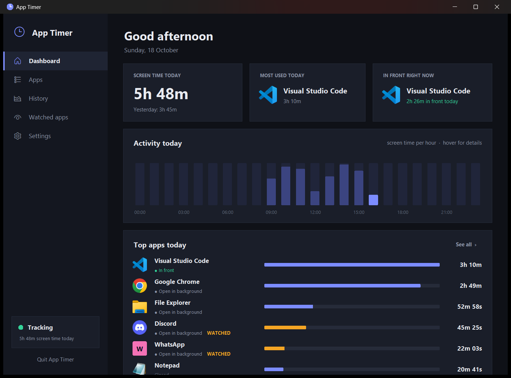
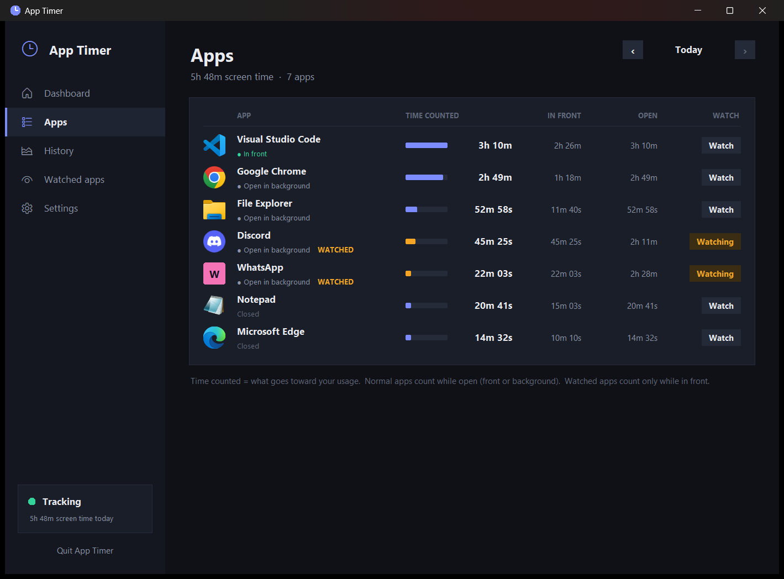
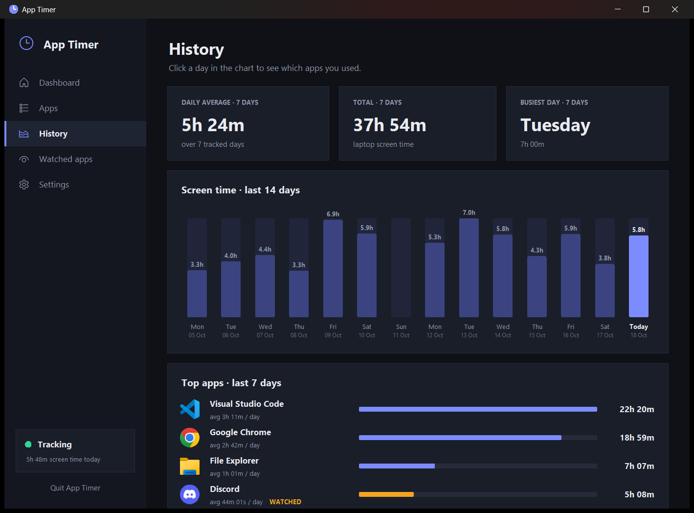
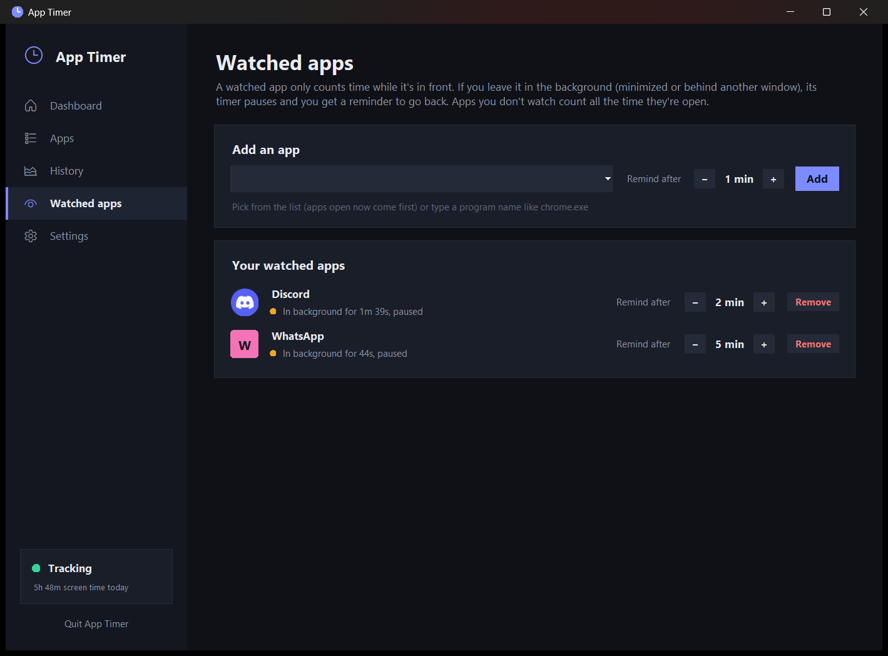
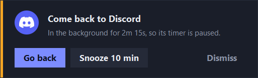
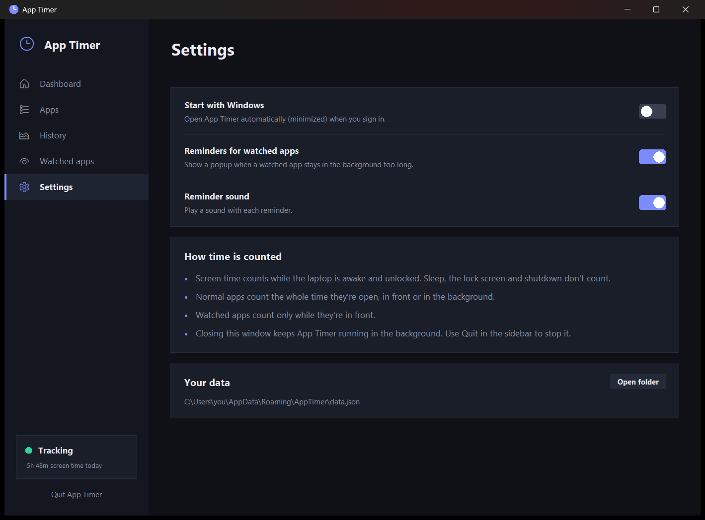

# ⏱ App Timer

A simple Windows app that tracks **how long your laptop is in use** and **how much time you spend in each app**.
It can also remind you to go back to an app you left running in the background.

## Features

- **Daily screen time.** Counts while your laptop is awake and unlocked. Sleep, the lock screen and shutdown don't count.
- **Time per app.** See how many hours you spend in each app, plus how long each one was in front and how long it was open.
- **Watched apps with reminders.** Choose any app to watch:
  - A watched app only counts time while it's **in front**.
  - If you leave it in the background (minimized or behind another window), its timer pauses and a popup reminds you to go back.
  - Apps you don't watch count the whole time they're open and never remind you.
- **History.** Screen time for the last 14 days, a daily average, your busiest day and your top apps of the week.
- **Activity by hour.** See which hours of the day you used your laptop most.
- **Runs quietly in the background**, and can start with Windows.
- **Private.** All data stays on your own PC. Nothing is uploaded anywhere.

## Screenshots

### Apps: time for every app, any day

### History: last 14 days

### Watched apps: get reminded to come back

The reminder popup that appears when a watched app stays in the background:

### Settings

## Download & install

1. **Install Python** (free) from [python.org/downloads](https://www.python.org/downloads/).
   On the first screen of the installer, tick **"Add python.exe to PATH"**.
2. **Download App Timer.** Click the green **Code** button at the top of this page and choose **Download ZIP**,
   or download [`App Timer.zip`](App%20Timer.zip).
3. **Extract the zip** (right-click it, choose **Extract All**) and double-click **`Start App Timer.bat`**.
   If Windows says *"Windows protected your PC"*, click **More info** and then **Run anyway**.
4. *(Recommended)* In **Settings**, turn on **Start with Windows**.

You don't need to install any other packages: App Timer only uses Python's standard library.
For step-by-step help, see [`SETUP.txt`](SETUP.txt).

## Good to know

- Closing the window **doesn't** stop tracking. App Timer stays on the taskbar.
  To stop it, click **Quit App Timer** at the bottom of the sidebar.
- Your data is saved in `%APPDATA%\AppTimer\data.json`.
- Works on Windows 10 and 11.
